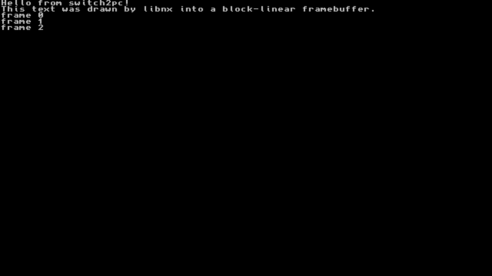
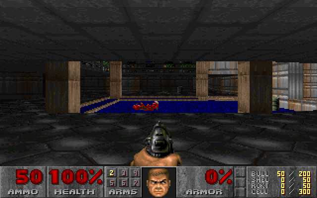
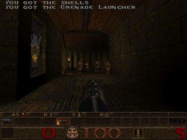
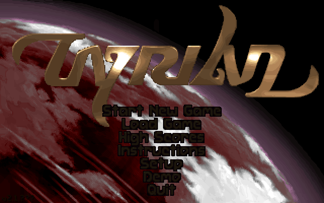

# switch2pc

Run Nintendo Switch executables natively on ARM64 Linux. No emulator, no virtual
CPU, no separate runtime process: the game binary is mapped into the process,
its supervisor calls are rewritten into traps, and a set of small shared
libraries (`libhos_*.so`) answer those traps the way the Switch kernel and
system services would.

What this is **not**: an x86-64 port, a Windows port, a decryption tool, or a
way to play commercial games today. It is the loader and kernel layer that such
things would need. See [docs/design.md](docs/design.md) for why the project
looks like this and what the original plan got wrong.

## Status

Phase 1, day 1. The pipeline is complete for a hand-written module:

```
$ build/host/src/switch2pc info build/aarch64/examples/hello/hello.nso
build/aarch64/examples/hello/hello.nso
  version       0   flags 0
  text     file 0x00000106  mem 0x00000000  size 0x00000063
  ...
  MOD0          absent
  patch sites   7 total, 7 svc->brk, 0 tpidrro_el0->tpidr_el0, 0 cntpct_el0->cntvct_el0

$ qemu-aarch64 -L /usr/aarch64-linux-gnu build/aarch64/src/hosrun build/aarch64/examples/hello/hello.nso
[s2pc thread] I: main thread 0x100: entry 0x8000000 stack [...) tls 0x3800000000
[s2pc hosrun] I: hello.nso: image 0x8000000+0x1000, 7 patches (7 svc), 0 relocs (0 unresolved)
[s2pc game ] I: hello from HOS
[s2pc svc  ] I: svcBreak User [notification] addr 0 size 0
[s2pc svc  ] I: svcExitProcess
```

Implemented: NSO0 parsing and LZ4, MOD0 relocation, instruction patching,
the trap/dispatch path, threads, the memory map (`SetHeapSize`, `MapMemory`,
`QueryMemory`), `GetInfo`, `Break`, `OutputDebugString`, `SleepThread`,
synchronisation (mutex and condition variable arbitration, `WaitForAddress`,
events, `WaitSynchronization`, thread exit as a waitable), and the IPC
transport (HIPC, CMIF and TIPC framing, domains, control commands) with the
`sm:` port and an `lm` log manager in `libhos_os.so`.

`examples/kernel_test` is a freestanding C module with MOD0 and relocations
that drives all of it from inside the process, the way an SDK runtime would:

```
$ qemu-aarch64 -L /usr/aarch64-linux-gnu build/aarch64/src/hosrun build/aarch64/examples/kernel_test/kernel_test.nso
[s2pc game ] I: PASS mutex: counter == 4000
[s2pc game ] I: PASS condvar: woke with mutex held
[s2pc game ] I: PASS ipc: sm GetService(lm)
[s2pc game ] I: hello via lm (domain)
[s2pc game ] I: kernel_test done
```

Also in: shared and transfer memory, multi-module loading (an exefs directory
with `rtld`, `main`, `subsdk*`, `sdk`, mapped back to back with symbols resolved
across modules), and service libraries for `set`/`set:sys`, `time`, `appletOE`/
`appletAE` (`libhos_os`), `hid` with its shared memory (`libhos_input`), and
`fsp-srv` serving the SD card and save data from host directories and the romfs
from an image file (`libhos_fs`).

**Phase 1 exit criterion met.** A real libnx binary ([examples/libnx_hello](examples/libnx_hello/),
built with devkitA64 by `scripts/build_libnx_hello.sh`) runs its own crt0 and
`__appInit` against our services (`sm`, `set:sys`, `appletOE`, `apm`, `hid`,
`fsp-srv`, sdmc mount), reaches `main`, and uses the heap, the time service,
files on `sdmc:/`, the hid shared memory, applet state and libnx threads,
mutexes and condition variables before exiting through `ISelfController::Exit`:

```
$ qemu-aarch64 -L /usr/aarch64-linux-gnu build/aarch64/src/hosrun --sdmc /tmp/sdmc examples/libnx_hello/build/hello.nso
[s2pc hosrun] I: 1 module, 182 patches (27 svc, 14 counter), 0 relocations (0 unresolved, 56 relr left to the module)
[s2pc game ] I: libnx hello: main reached (argc=0)
[s2pc game ] I: time() = 1791555534 -> 2026-10-09 14:18 UTC
[s2pc game ] I: sdmc read back: "written by libnx"
[s2pc game ] I: thread counter 5000 (expect 5000)
[s2pc game ] I: libnx hello: done
```

**Display path.** `libhos_gpu` implements `nvdrv` (nvmap and nvhost-ctrl, no
GPU behind them) and `vi` with the Android binder / IGraphicBufferProducer
protocol libnx and the SDK use to hand frames to the compositor. There is no
screen yet: a queued buffer is consumed on the spot, and with `HOS_FRAMES=<dir>`
every frame is deswizzled from the game's own memory (Tegra 16Bx2 block-linear,
any pixel size) and written as a PPM. This is a libnx `consoleInit` + `printf`
program ([examples/libnx_console](examples/libnx_console/main.c)) seen through
that path:



Also in: `audout` as a null sink that releases buffers at once and can dump the
PCM (`HOS_AUDIO_DUMP=<file>`), `nifm` reporting an offline console, and a romfs
built on the fly from a directory (`--romfs <dir>`; tables in memory, file data
read from the host files on demand, so a large romfs costs nothing up front).
The `libnx_services` and `libnx_romfs` examples drive these through libnx's own
client code.

**A complete game runs.** [examples/doom](examples/doom/main.c) is DOOM
(doomgeneric, software renderer) with a 120-line libnx platform layer, built
by `scripts/build_doom.sh` against the free shareware IWAD. It starts in E1M1,
plays from a scripted pad, and every frame goes through the same framebuffer,
nvmap, hid and romfs paths a retail title uses. Frame 400, headless, under
qemu-user:



Quake runs too: [examples/quake](examples/quake/main.c) is quakegeneric
(the original software renderer, built as 64-bit without a single engine
patch) with the shareware data, playing its demo loop here:



**SDL2 games run unmodified.** [ports/sdl2](ports/sdl2/) is a software video
driver for devkitPro's Switch fork of SDL 2.28 (`scripts/build_sdl2.sh`): the
window is a libnx framebuffer, audio goes through `audout`, the joystick comes
from `hid`, so a game written against plain SDL2 needs no platform code at all.
[examples/sdl_test](examples/sdl_test/main.c) checks that path (software
renderer, queued tone, controller events), and
[OpenTyrian](https://github.com/opentyrian/opentyrian) is the first real one:
built as-is by `scripts/build_opentyrian.sh` with the freeware Tyrian 2.1 data,
it plays through the intro, menus and levels, and leaves cleanly on the applet
exit request (the input script's `exit` line, what closing a title from the
HOME menu sends):



Two things bit on the way there, both now in the scripts: the Switch SDL build
turns `SDL_CPUINFO` off, and without it SDL installs no audio converters on
ARMv8 (every rate or format change fails), so the build forces it on; and
`audout` has to pace buffers at the sample rate, because a sink that releases
them at once lets SDL's audio thread spin on the IPC lock and starves the game.

To play any of them from Windows (WSL2 host), build everything, then:

```
scripts/build_doom.sh        # once, from Git Bash (build_quake.sh, build_opentyrian.sh likewise)
scripts/run_game.sh doom     # opens a window; arrows move, Z fires, X uses, Enter/Esc for menus
scripts/run_game.sh quake 3  # second argument is the window scale
scripts/run_game.sh tyrian 2
```

The window is hosrun's own (`HOS_WINDOW=1`): an X11 window, shown on Windows
through WSLg, that opens on the first frame at `HOS_WINDOW_SCALE` times the
frame size, scales and letterboxes on resize, owns the keyboard (WASD also
drive the left stick) and, when closed, sends the applet exit request so the
game quits through its own loop. It needs the target's libX11, which on an
x86-64 host comes from Ubuntu's arm64 ports (`sudo scripts/setup_wsl_arm64_libs.sh`,
then reconfigure `build/aarch64`). Without it, `run_game.sh <game> 2 --viewer`
falls back to the older path: hosrun writes a BMP (`HOS_FRAMES_LIVE`) that
`tools/viewer.ps1` shows, and reads the pad from a file (`HOS_INPUT_FILE`).
Either way it is playable, about 30 fps under qemu-user on a desktop CPU.

Sound plays for real with `HOS_AUDIO=auto` (which `run_game.sh` sets):
`audout` writes each game buffer to PulseAudio, which WSLg forwards to
Windows, or to ALSA on a plain Linux box, and releases it once the device
has taken it, so the game's audio thread runs on the device clock. Both
libraries are loaded at run time, so they are not build dependencies; without
`HOS_AUDIO` the buffers are paced by a timer and nothing is played, which is
what the tests use.

Input reaches the game the way it does on hardware: a writer thread refreshes
player 1's Npad LIFO in the hid shared memory at 60 Hz, from a timed script
(`HOS_INPUT_SCRIPT`) or a Linux gamepad (`HOS_INPUT_EVDEV=auto`). The
`libnx_input` example is the stock homebrew main loop and leaves on Plus.

Also answered: `acc:u0` with one local user (nickname from `HOS_USER_NAME` or
`$USER`) and `psm` with a full battery on the official charger.

Sockets work: `bsd:u` is served with host sockets (TCP and UDP over IPv4,
poll, non-blocking mode, socket options), so homebrew that talks to the
network through libnx's POSIX API runs unchanged; `examples/libnx_sockets`
checks it. Name lookups (`sfdnsres`) are not served yet, so use numeric
addresses.

The GPU has started ([docs/gpu.md](docs/gpu.md), milestones M0 and M1): a
deko3d program creates its device, swapchain and queue, and its clears,
buffer copies, image uploads and inline data now run, on the CPU, through
the GPU's own command stream, including the macros the 3D engine executes.
Triangles and 3D meshes render too, with real Maxwell shaders compiled by
deko3d's toolchain and run by an interpreter in `hos_gpu`: deko3d's
triangle, its rotating cube (vertex buffer, uniform matrices), a scene
with depth testing and alpha blending, and textured quads (RGBA8 and BC1,
nearest and bilinear, clamp and repeat) match independent references pixel
for pixel. The GPU runs on the CPU for now; a Vulkan backend is next.

Not implemented yet: the GPU's Vulkan backend and mipmaps, DNS lookups,
`pctl`, config files. Track progress in
[docs/ISSUES.md](docs/ISSUES.md).

## Quick start

Ubuntu 24.04 (native ARM64, or x86-64 with WSL2):

```
sudo apt install build-essential cmake ninja-build gcc-aarch64-linux-gnu \
                 libc6-dev-arm64-cross qemu-user-static gdb-multiarch
scripts/build.sh
```

That builds the host tool, cross-builds the ARM64 runtime, packages the hello
example and runs every test under qemu-user. On a real ARM64 box drop the
toolchain file and the emulator and build once:

```
cmake -S . -B build -G Ninja && cmake --build build && ctest --test-dir build
build/src/hosrun build/examples/hello/hello.nso
```

## Usage

```
switch2pc info  <module.nso>          header, MOD0, how many instructions will be rewritten
switch2pc scan  <module.nso>          every rewrite site with offsets and svc numbers
switch2pc patch <in.nso> <out.nso>    write a pre-patched, uncompressed copy
switch2pc mknso --text <bin> -o <out.nso> [--rodata <bin>] [--data <bin>] [--bss <n>] [--compress]
switch2pc elf2nso <in.elf> -o <out.nso> [--name <str>] [--compress]   static-PIE ELF with MOD0 -> NSO

hosrun [options] <module.nso> [more.nso ...]      modules mapped back to back, first one is entered
hosrun [options] <exefs directory>                  loads rtld, main, subsdk0-9, sdk by name
  --stack <bytes>  --no-patch  --romfs <file>  --sdmc <dir>  --save <dir>
```

Environment: `HOS_LOG_LEVEL=error|warn|info|debug|trace`, `HOS_BREAK=continue`
to resume after a fatal `svcBreak`, `HOS_ROMFS`/`HOS_SDMC`/`HOS_SAVE` as the
options above.

Debugging: `qemu-aarch64 -g 1234 hosrun game.nso` then
`gdb-multiarch -ex 'target remote :1234' hosrun`. Game code shows up at
`0x8000000` plus the offset `switch2pc scan` prints. `strace -f` on a native
box shows `nanosleep`, `mremap`, `clone`: the game's own calls, nothing else.

## How it works

```
 module.nso ──► hosrun ──┬── nso_load       LZ4 segments → anonymous mapping at 0x8000000
                         ├── patch_text     svc #n → brk #n, mrs tpidrro_el0 → tpidr_el0,
                         │                  mrs cntpct_el0 → cntvct_el0 (one word each)
                         ├── mod0_relocate  .dynamic RELA/JMPREL against the module itself
                         ├── mprotect       text r-x, rodata r--, data rw-
                         └── hos_cpu_run_main   tpidr_el0 = HOS TLS block, sp = new stack, br entry

 game thread            brk #0x0B
   │                      │  SIGTRAP
   │                      ▼
   │     libhos_cpu  hos_trap_entry (asm): tpidr_el0 ← host TCB
   │                 hos_trap_c:  x0..x7 → hos_svc_dispatch(0x0B) → nanosleep()
   │                              pc += 4, tpidr_el0 ← HOS TLS
   ◄──────────────────────┘
```

Every game thread is an ordinary pthread whose `tpidr_el0` holds a HOS Thread
Local Region while game code runs. The trap entry swaps the host TCB back in so
libc works inside the shim, then restores the game block before `sigreturn`.
HOS address-space regions (heap at `0x1000000000`, alias, stack, TLS arena) are
reserved up front so `GetInfo` and `QueryMemory` can answer like the real kernel.

Why patch instead of using seccomp or a hypervisor: a one-word rewrite keeps
code size and every relative branch intact, works under qemu-user and on bare
metal, and shows up in a disassembler as exactly what it is. Trampolines
instead of signals are a later optimisation (#5).

## Repository

```
src/common     result codes, logger, file helpers
src/nso        NSO0 parser and writer, LZ4 block codec, MOD0 relocation
src/patch      instruction classifier and rewriter
src/cli        switch2pc (host tool)
src/loader     hosrun (ARM64 loader)
shims/hos_cpu  libhos_cpu.so: trap handler, svc table, threads, sync, memory map, shared memory, IPC, sm:
shims/hos_os   libhos_os.so: lm, set, set:sys, time, appletOE/appletAE
shims/hos_input libhos_input.so: hid (shared memory, no real input yet)
shims/hos_fs   libhos_fs.so: fsp-srv over host directories and a romfs image
shims/hos_gpu  libhos_gpu.so: nvdrv (nvmap, nvhost-ctrl), vi + binder bufferqueue, swizzle, frame dump
shims/hos_audio libhos_audio.so: audout null sink (optional raw PCM dump)
shims/hos_net  libhos_net.so: nifm reporting "no connection"
examples/hello the first end-to-end module (assembly, no MOD0)
examples/kernel_test  freestanding C module with MOD0: threads, sync, IPC, domains, services
examples/multi_module main + sdk modules linked at load time
examples/libnx_*      real libnx programs (hello, console, services); built with scripts/build_libnx.sh
tests          unit tests (host) and runtime tests (ARM64, qemu)
docs           design notes, issue tracker
```

## Platforms

| Host                 | Build tool | Build runtime | Run           |
|----------------------|------------|---------------|---------------|
| Linux ARM64          | yes        | yes           | native        |
| Linux x86-64 / WSL2  | yes        | cross         | qemu-user     |
| Windows              | no         | no            | no            |

x86-64 execution would need a static ARM64 to x86-64 recompiler. That is a
different project; this one deliberately does not start it.

## Code style

C11, `-Wall -Wextra -Werror`, 4 spaces, 100 columns, `snake_case`, every public
function documented in its header, `hos_result` for every fallible call, no
`malloc` in the shims (mmap only), every `FIXME` carries an issue number from
`docs/ISSUES.md`. `.clang-format` is authoritative.

## Contributing

See [CONTRIBUTING.md](CONTRIBUTING.md). Good first targets: #3 (events and
`WaitSynchronization` on futex), #1 (SHA-256 segment hashes), #6 (TOML config).

## Legal

This repository contains no Nintendo code, keys or assets and does not decrypt
anything. Test modules are assembled from source in `examples/`. Running a
commercial title would additionally require extracting its NSO, which this
project does not do and will not add; see the design notes.

## License

MIT.
